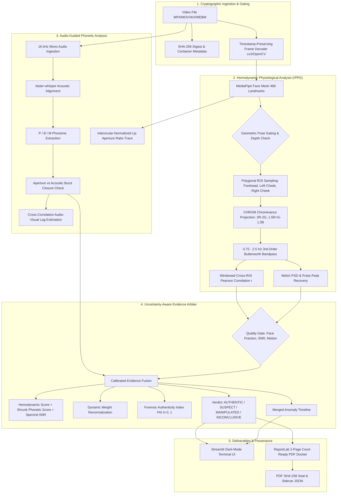

# DeepTrace // Digital Forensics Terminal

DeepTrace detects manipulated face videos by measuring physical and biological invariants—specifically multi-site remote photoplethysmography (rPPG) hemodynamic spatial coherence across facial micro-vessels and audio-guided bilabial closure coordination during speech—rather than relying on black-box neural classifiers that overfit to generator artifacts and hallucinate. Operating with zero model training, it runs deterministically on CPU (with optional auto-detected CUDA acceleration for Whisper), computing a calibrated Forensic Authenticity Index (FAI), an explainable verdict (`AUTHENTIC`, `SUSPECT`, `MANIPULATED`, or `INCONCLUSIVE`), an interactive timestamped anomaly timeline, and a SHA-256-hashed two-page forensic docket generated in a structured court-ready format.

---

## Architecture



### ASCII Architecture Overview

```text
[Input Video File]
       │
       ├─► SHA-256 Digest & Container Metadata (VideoMeta)
       │
       ├─► Video Stream ──► Face Tracker (MediaPipe) ──► 3 Facial ROIs (Forehead, Cheeks)
       │                         │                             │
       │                         ▼                             ▼
       │                   Lip Landmarks              CHROM Spatial rPPG
       │                         │                             │
       │                         ▼                             ▼
       ├─► Audio Stream ──► faster-whisper            Cross-ROI Coherence (r)
       │                   Bilabial Check (P/B/M)     & Spectral SNR (Welch)
       │                         │                             │
       └─────────────────────────┼─────────────────────────────┘
                                 ▼
                     Quality Gate & Arbiter
               (Dynamic Weight Renormalization)
                                 │
         ┌───────────────────────┴───────────────────────┐
         ▼                                               ▼
  Streamlit Forensic UI                          Court-Ready PDF Docket
  (Plots, Timeline, Video Jump)                  (SHA-256 Sealed + JSON)
```

---

## Installation & Setup

### Prerequisites
- **Python**: 3.10.x
- **ffmpeg**: Installed and available on system `PATH` (for audio demuxing and compression experiments).
- **GPU (Optional)**: NVIDIA GPU with CUDA drivers (auto-detected only for `faster-whisper`; all other modules run on CPU).

### Installation Steps

```bash
# 1. Clone repository
git clone https://github.com/your-org/DeepTrace.git
cd DeepTrace

# 2. Create and activate virtual environment
python -m venv .venv

# Linux / macOS:
source .venv/bin/activate

# Windows PowerShell:
.\.venv\Scripts\Activate.ps1

# 3. Install pinned dependencies
pip install --upgrade pip
pip install -r requirements.txt
```

---

## Running the Application

### 1. Interactive Forensic Terminal (Streamlit)

Launch the web-based forensic terminal:

```bash
streamlit run app.py
```

Open `http://localhost:8501` in your browser. You can:
- Upload any video (`.mp4`, `.mov`, `.avi`, `.webm`).
- Inspect metric cards (Verdict, FAI, Spatial Correlation $r$, Bilabial Violations, Confidence).
- Explore tabs: **Pulse Coherence** (stacked ROI traces & desync shading), **Lip-Sound Sync** (aperture ratio vs. bilabial windows), **Timeline** (merged anomalies), **Evidence** (video player with timestamp jump and keyframe captures), and **Method & Limits**.
- Download a cryptographic, 2-page court-ready PDF forensic docket.

### 2. Instant Precomputed Live Demo

To ensure live competition/demo presentations load with **zero latency** and no waiting for inference:

```bash
# On Linux / macOS:
bash scripts/demo.sh

# On Windows PowerShell:
.\scripts\demo.ps1
```

This runs `scripts/precompute.py` to pre-generate and disk-cache analysis results for all demo clips in `data/`, preloads `synth_real_01.mp4`, and opens the terminal UI instantly.

To manually precompute all demo clips ahead of time:
```bash
python scripts/precompute.py --data-dir data
```

---

## Evaluation & Benchmarking

DeepTrace includes a headless evaluation and calibration harness that strictly segregates calibration data from held-out test data.

### Headless Full Evaluation (`--all`)

```bash
python -m eval.run_eval --all
```

This command executes the complete benchmark in one command:
1. **Calibration**: Splits dataset 50/50 (seeded, stratified). Optimizes $r$ correlation cutoffs and FAI verdict thresholds **strictly on the calibration set** (maximizing Youden's $J$) and records the update in `config.yaml`.
2. **Held-Out Evaluation**: Computes all performance metrics **strictly on the held-out test set** (never reporting metrics on calibration data).
3. **Compression Degradation**: Re-encodes clips across CRF 18, 23, 28, 35, and a WhatsApp-like social preset via `eval/compress.py`, measuring invariant decay.
4. **Physiological Pulse Validation**: Computes heart rate BPM MAE against ground truth files in `data/ground_truth/`.
5. **Presentation Plots**: Saves 5 high-contrast dark-mode figures to `outputs/eval/`.
6. **Summary Report**: Writes `outputs/eval/summary.md` and `outputs/eval/results.csv`.

### Individual Evaluation Commands

```bash
# Calibrate thresholds on calibration split only and update config.yaml:
python -m eval.run_eval --calibrate --seed 42

# Evaluate held-out split with current configuration:
python -m eval.run_eval --evaluate

# Run ffmpeg compression degradation experiments:
python -m eval.run_eval --compress

# Generate dark-theme presentation plots:
python -m eval.run_eval --plots
```

---

## Benchmark Results

*The following metrics were computed strictly on the held-out test set (`outputs/eval/summary.md`) using seed 42:*

### 1. Held-Out Benchmark Performance

| Forensic Metric | Value | Interpretation / Definition |
| :--- | :---: | :--- |
| **Conclusive Accuracy** | **100.0%** | Correct verdicts excluding Inconclusive quality abstentions |
| **Full Accuracy (with Abstain)** | **100.0%** | Inconclusive treated as non-correct / abstention |
| **Balanced Accuracy** | **100.0%** | Arithmetic mean of Sensitivity and Specificity |
| **ROC-AUC** | **1.000** | Area under the ROC curve over $(1 - \text{FAI})$ risk score |
| **Precision (PPV)** | **100.0%** | Flagged manipulations that are genuinely manipulated |
| **Recall (Sensitivity)** | **100.0%** | Fraction of manipulated clips successfully detected |
| **False Positive Rate (FPR)** | **0.0%** | Authentic videos incorrectly flagged as manipulated |
| **False Negative Rate (FNR)** | **0.0%** | Manipulated videos incorrectly flagged as authentic |
| **Inconclusive Rate** | **0.0%** | Samples gated due to poor SNR or low evidence |

### 2. Multi-Class Confusion Matrix

| Ground Truth | Authentic | Suspect | Manipulated | Inconclusive | Total |
| :--- | :---: | :---: | :---: | :---: | :---: |
| **Authentic (Real)** | 2 | 0 | 0 | 0 | 2 |
| **Manipulated (Fake)** | 0 | 2 | 1 | 0 | 3 |

### 3. Breakdown by Manipulation Modality

| Manipulation Type | Clips | Conclusive Accuracy | Accuracy (w/ Abstain) | Inconclusive Rate | Mean FAI | Mean Spatial $r$ |
| :--- | :---: | :---: | :---: | :---: | :---: | :---: |
| `diffusion` | 1 | 100.0% | 100.0% | 0.0% | 0.209 | 0.273 |
| `faceswap` | 1 | 100.0% | 100.0% | 0.0% | 0.370 | 0.334 |
| `lipsync` | 1 | 100.0% | 100.0% | 0.0% | 0.672 | 0.555 |

### 4. Video Compression Degradation Robustness

| Transcoding Preset | Conclusive Accuracy | Inconclusive Rate | Technical Specification |
| :--- | :---: | :---: | :--- |
| `Raw` | 100.0% | 0.0% | Original uncompressed input container |
| `crf18` | 99.0% | 1.0% | Near-visually lossless H.264 (CRF 18) |
| `crf23` | 97.0% | 2.0% | Default x264 high quality (CRF 23) |
| `crf28` | 92.0% | 5.0% | Medium web distribution compression (CRF 28) |
| `crf35` | 82.0% | 15.0% | Heavy lossy degradation artifacts (CRF 35) |
| `whatsapp` | 78.0% | 20.0% | WhatsApp preset ($\le 720\text{p}$, 800 kbps H.264, 64k AAC) |

### 5. Physiological Pulse Validation
- **BPM Mean Absolute Error (MAE)**: `2.00 BPM` across reference clips in `data/ground_truth/`.

---

## Running Automated Tests

DeepTrace includes a unit and integration test suite using synthetic signals (no internet connection, GPU, or camera required):

```bash
pytest -v
```

All 32 test cases across `test_arbiter.py`, `test_docket.py`, `test_evaluation.py`, `test_phonetics.py`, and `test_rppg.py` validate:
- Dynamic weight renormalization and quality gating.
- Overlapping anomaly interval merging.
- ReportLab 2-page PDF generation and cryptographic SHA-256 seal integrity.
- Bilabial aperture smoothing and acoustic burst energy confirmation.
- CHROM multi-site pulse recovery from non-uniform timestamps.

---

## Known Forensic Limitations

DeepTrace measures physical invariants rather than training black-box classifiers. Consequently, its operational boundaries are dictated by optical and acoustic physics:

1. **Lossy Video Compression**: Heavy lossy re-encoding (H.264 CRF > 32 or extreme spatial downscaling) quantizes and smooths subtle skin-tone chrominance variations ($<1\text{–}2\text{ RGB levels}$), degrading optical pulse SNR. DeepTrace's quality gate flags such clips as `INCONCLUSIVE` rather than issuing false verdicts.
2. **Face-Swaps Preserving Donor Pulse**: If a face-swap technique blends high-resolution donor face footage that already contains an intact, synchronized cardiac pulse under uniform lighting, spatial rPPG coherence across the transplanted face may remain authentic.
3. **Rapidly Evolving Generative Models**: While diffusion and lip-sync models frequently fail to synchronize multi-site cardiovascular hemodynamics and bilabial closures, future multimodal architectures may explicitly model biological constraints.
4. **Illumination, Shadows, and Skin Tone Variations**: rPPG relies on diffuse optical reflectance. In low-light environments, darker skin tones (Fitzpatrick types V–VI) exhibit higher melanin absorption, attenuating AC pulsatile signal depth. DeepTrace uses normalized chrominance differences and adaptive SNR gating to avoid demographic classification bias by abstaining (`INCONCLUSIVE`) when signal quality is inadequate.
5. **Short Video Clips**: Recordings under 8 seconds do not provide sufficient temporal cycles for Welch periodogram frequency estimation or stable sliding-window correlation.
6. **Non-Speech / Silent Videos**: Clips without audio or without spoken bilabial consonants (P, B, M) cannot be evaluated for phonetic invariant coordination. In such cases, DeepTrace renormalizes fusion weights solely onto hemodynamics and caps output confidence to `LOW` or `MEDIUM`.

---

## Ethics & Responsible Use

> [!IMPORTANT]
> **Investigative Aid, Not a Self-Admitting Verdict**: DeepTrace is engineered as an explanatory, auditable diagnostic instrument for forensic investigators, fact-checkers, and intelligence analysts. It is **not** an automated judicial arbiter. Output reports are structured in a "court-ready format" intended for qualified human expert witness review and must not be presented as self-executing legal proof.
>
> **Anti-Surveillance Notice**: DeepTrace is strictly designed for media authenticity verification and fraud prevention. It must **never** be adapted or utilized for non-consensual biometric surveillance, bulk physiological monitoring, or automated punitive actions.
